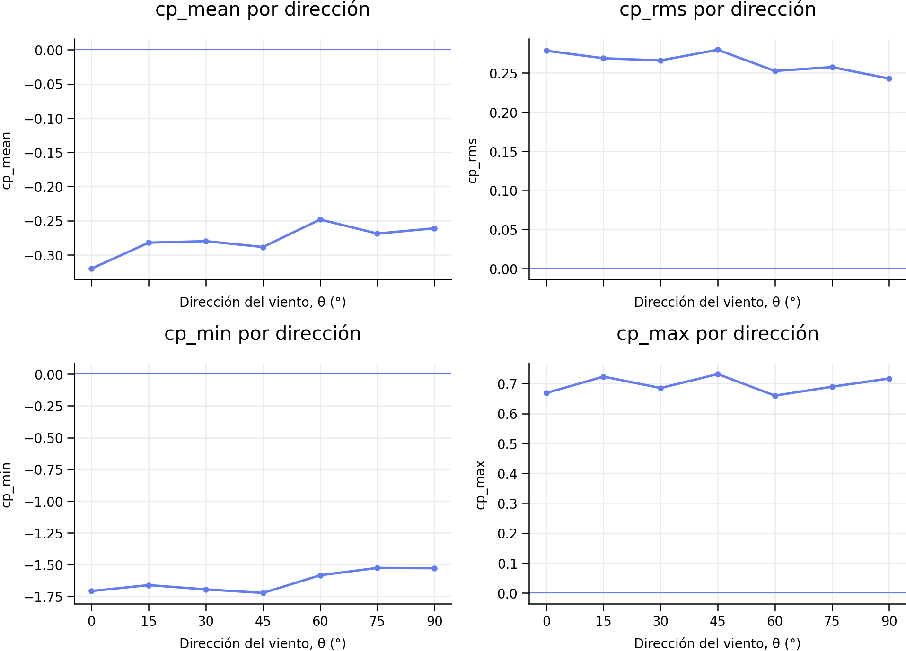
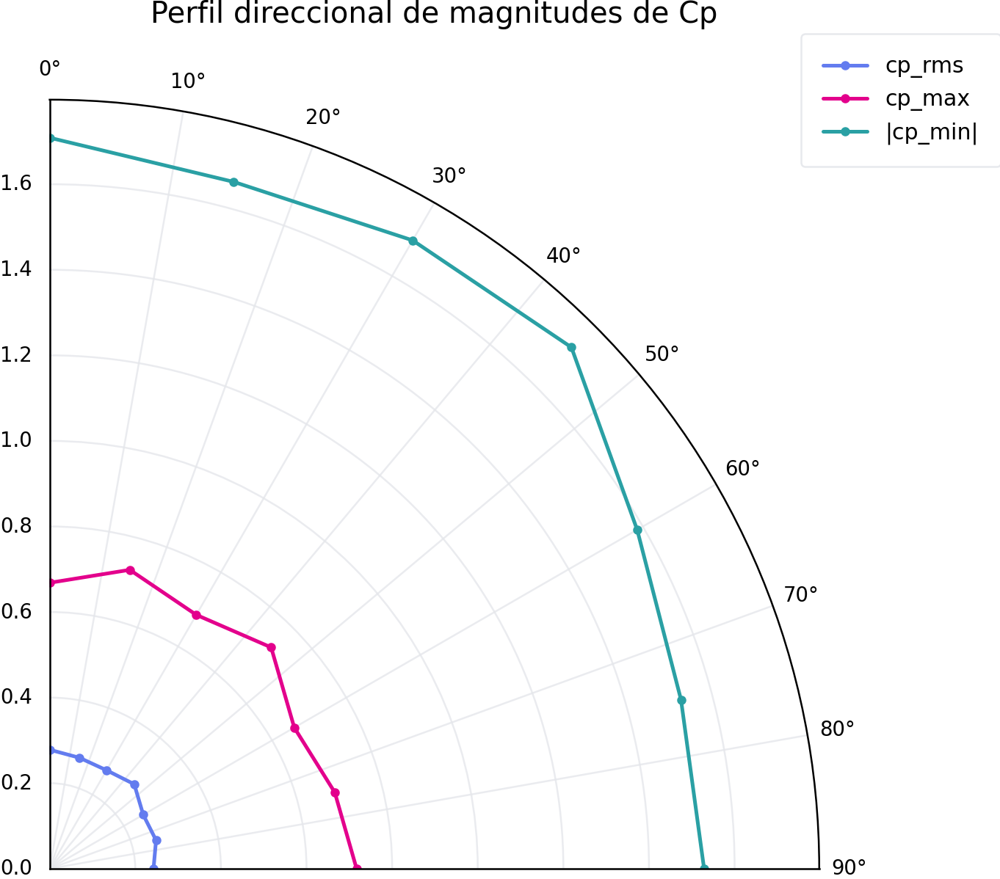
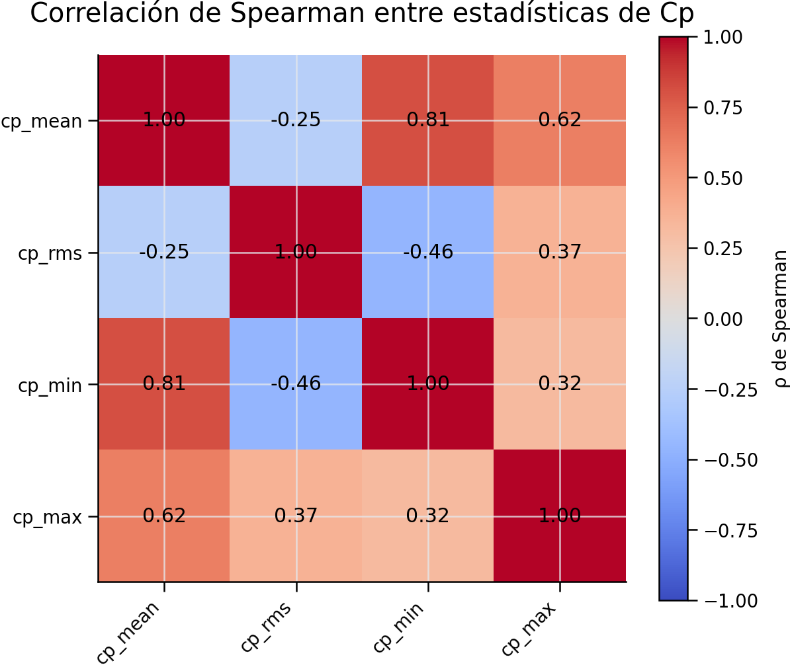
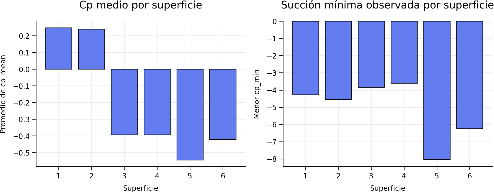
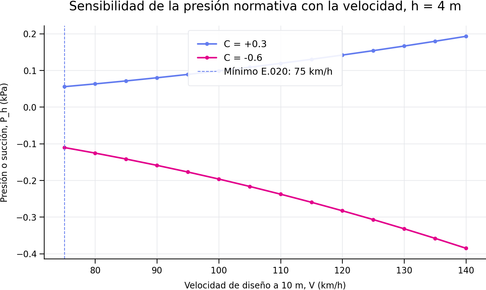

# Predicción educativa de coeficientes de presión superficial con datos TPU

[](https://www.python.org/)
[](https://scikit-learn.org/)
[](https://www.gob.pe/institucion/sencico/informes-publicaciones/887225-normas-del-reglamento-nacional-de-edificaciones-rne)
[](#alcance-y-advertencia-de-uso)

## Resumen

Este repositorio presenta un flujo reproducible para verificar la calidad de datos de presión superficial, realizar análisis exploratorio y comparar modelos de regresión para estimar cuatro estadísticas adimensionales del coeficiente de presión, `Cp`:

- `cp_mean`: presión media;
- `cp_rms`: intensidad de las fluctuaciones;
- `cp_min`: succión mínima observada;
- `cp_max`: sobrepresión máxima observada.

Los datos proceden de ensayos de túnel de viento de la **Tokyo Polytechnic University (TPU)** para una edificación baja con cubierta a dos aguas. El proyecto conecta esos datos experimentales con un ejemplo educativo basado en la **Norma Técnica E.020 Cargas del Reglamento Nacional de Edificaciones del Perú** y propone una vía responsable para incorporar registros meteorológicos oficiales del **SENAMHI**.

> [!IMPORTANT]
> Los modelos de aprendizaje automático de este repositorio no sustituyen la Norma E.020, un estudio de viento específico, un ensayo de túnel de viento ni la revisión de un ingeniero estructural habilitado. Los resultados no deben emplearse directamente para dimensionar cubiertas, paneles, vidrios, anclajes o elementos resistentes.

## Objetivos de aprendizaje

1. Auditar integridad, completitud, duplicados, infinitos y coherencia del conjunto TPU.
2. Comprender la variación espacial y angular de `Cp`.
3. Evitar fuga de información en datos con sensores repetidos entre direcciones.
4. Comparar una línea base, Ridge, Random Forest, Extra Trees e HistGradientBoosting.
5. Evaluar MAE, RMSE, R², error máximo, sesgo y estabilidad entre pliegues.
6. Diferenciar coeficientes aerodinámicos de presión de las velocidades meteorológicas locales.
7. Relacionar, solo con fines educativos, `Cp` y las cargas mínimas de viento de la NTE E.020.

## Estructura del repositorio

```text
Entregable 2/
├── data/
│   └── raw/                         # 7 archivos MAT de series temporales
├── outputs/
│   └── TPU_Gable_0-90_tabla_por_punto.csv
├── reports/
│   └── resultados_notebook/         # métricas, predicciones y gráficos
├── models/                           # modelos serializados después de validar
├── scripts/
│   └── 01_limpieza_eda_tpu.py
├── src/tpu_cp/
├── configs/schema.yml
├── Prediccion_coeficientes.ipynb
├── requirements.txt
├── BITACORA_IA.md
└── README.md
```

## Datos experimentales TPU

### Geometría y adquisición

| Característica | Valor documentado |
|---|---:|
| Cubierta | A dos aguas, `gable roof` |
| Altura al alero, H | 4 m |
| Ancho, B | 16 m |
| Profundidad, D | 16 m |
| Relación H/B | 0.25 |
| Pendiente de cubierta | 5° |
| Direcciones | 0°, 15°, 30°, 45°, 60°, 75° y 90° |
| Sensores por dirección | 128 |
| Superficies | 6 |
| Frecuencia de muestreo | 15 Hz |
| Duración por dirección | 600 s |
| Muestras por sensor y dirección | 9 000 |

La selección contiene **8 064 000 valores de Cp** y produce **896 registros sensor-ángulo** después de resumir cada serie: `128 sensores × 7 direcciones`. Los 896 registros no son 896 ensayos independientes.

La documentación general de TPU indica que la base de edificios bajos se obtuvo en un túnel de capa límite, con escala geométrica 1:100, terreno suburbano equivalente a categoría III de AIJ, exponente del perfil medio 0.20 y velocidad equivalente aproximada de 22 m/s a 10 m en escala completa. Estos valores describen el ensayo general y deben verificarse contra los metadatos del caso descargado antes de usarlos en cualquier comparación cuantitativa.

### Control de calidad verificado

| Comprobación | Resultado |
|---|---:|
| Archivos MAT | 7 |
| Sensores por archivo | 128 |
| Muestras por sensor | 9 000 |
| Valores Cp faltantes | 0 |
| Valores Cp infinitos | 0 |
| Identificadores duplicados dentro de archivo | 0 |
| Combinaciones sensor-ángulo duplicadas | 0 |
| Geometrías diferentes | 1 |

### Definición de las variables objetivo

```python
cp_mean = np.mean(serie)
cp_rms  = np.sqrt(np.mean((serie - cp_mean) ** 2))
cp_min  = np.min(serie)
cp_max  = np.max(serie)
```

| Nombre corto | Columna consolidada | Definición |
|---|---|---|
| `cp_mean` | `cp_mean_10min` | Media temporal de Cp |
| `cp_rms` | `cp_rms_fluctuation_10min` | RMS de la fluctuación respecto a la media |
| `cp_min` | `cp_min_0p2s_moving_average` | Mínimo de la señal procesada |
| `cp_max` | `cp_max_0p2s_moving_average` | Máximo de la señal procesada |

Los extremos pertenecen a la duración y al procesamiento del ensayo. No representan automáticamente valores de diseño asociados a un periodo de retorno.

## Resultados descriptivos de la selección

### Resumen de 896 registros

| Variable | Media | Desv. estándar | Mínimo | Mediana | Máximo |
|---|---:|---:|---:|---:|---:|
| `cp_mean` | -0.2786 | 0.4377 | -1.6956 | -0.2973 | 0.8319 |
| `cp_rms` | 0.2635 | 0.1241 | 0.1229 | 0.2193 | 0.9124 |
| `cp_min` | -1.6330 | 1.1167 | -8.0377 | -1.3147 | -0.1243 |
| `cp_max` | 0.6964 | 0.8324 | -0.2124 | 0.3644 | 3.5038 |

La superficie 5 contiene la succión más negativa observada, `cp_min = -8.0377`. Este valor debe trazarse al sensor, dirección, superficie y señal temporal antes de considerarlo un fenómeno físico representativo.

### Promedios por dirección

| θ | `cp_mean` | `cp_rms` | `cp_min` | `cp_max` |
|---:|---:|---:|---:|---:|
| 0° | -0.3203 | 0.2782 | -1.7087 | 0.6684 |
| 15° | -0.2823 | 0.2686 | -1.6621 | 0.7233 |
| 30° | -0.2801 | 0.2658 | -1.6960 | 0.6852 |
| 45° | -0.2887 | 0.2794 | -1.7236 | 0.7317 |
| 60° | -0.2484 | 0.2524 | -1.5847 | 0.6598 |
| 75° | -0.2690 | 0.2573 | -1.5268 | 0.6895 |
| 90° | -0.2613 | 0.2426 | -1.5287 | 0.7170 |

Los promedios por dirección son útiles para comparar tendencias globales, pero pueden ocultar succiones locales críticas.


### Gráficos de comportamiento aerodinámico



**Lectura del gráfico:**

- `cp_mean` alcanza el promedio más negativo a **0°** (`-0.3203`). El rango entre direcciones es pequeño, aproximadamente **0.0719**, pero el promedio espacial puede ocultar picos locales.
- `cp_rms` alcanza su mayor promedio a **45°** (`0.2794`) y disminuye hasta `0.2426` a 90°. El rango direccional es **0.0368**.
- `cp_min` presenta la succión media más intensa a **45°** (`-1.7236`). Entre 45° y 90° la magnitud media de succión disminuye aproximadamente 11.3 %, aunque debe revisarse el sensor crítico y no solo el promedio.
- `cp_max` alcanza su mayor promedio a **45°** (`0.7317`). El rango direccional es **0.0719**.



El diagrama polar representa `cp_rms`, `cp_max` y la magnitud `|cp_min|`. No es una rosa de viento meteorológica. Sirve para visualizar la dependencia angular de las respuestas aerodinámicas medidas. La magnitud de la succión domina en todas las direcciones, lo que refuerza la necesidad de revisar fijaciones y zonas locales de cubierta en un análisis estructural posterior.

### Correlación de Spearman

| Variable | `cp_mean` | `cp_rms` | `cp_min` | `cp_max` |
|---|---:|---:|---:|---:|
| `cp_mean` | 1.0000 | -0.2507 | 0.8124 | 0.6238 |
| `cp_rms` | -0.2507 | 1.0000 | -0.4555 | 0.3652 |
| `cp_min` | 0.8124 | -0.4555 | 1.0000 | 0.3157 |
| `cp_max` | 0.6238 | 0.3652 | 0.3157 | 1.0000 |

La correlación describe asociación monotónica, no causalidad. H, B, D y H/B son constantes y no pueden utilizarse para inferir efectos geométricos.




La asociación `cp_mean`–`cp_min` es elevada y positiva (`ρ = 0.8124`): sensores con una presión media más negativa suelen presentar mínimos más negativos. La relación `cp_rms`–`cp_min` es moderada y negativa (`ρ = -0.4555`), compatible con mayores fluctuaciones asociadas a succiones mínimas más intensas. Estas asociaciones no justifican usar un objetivo como predictor de otro, porque podrían introducir fuga de información.

### Análisis por superficie



- Las superficies 1 y 2 muestran `cp_mean` promedio positivo, mientras que las superficies 3 a 6 presentan promedio negativo.
- La superficie 5 concentra el mínimo más severo, `cp_min = -8.0377`.
- La superficie 6 alcanza `cp_min = -6.2492`.
- La diferencia entre promedios y extremos confirma que un promedio global no es suficiente para localizar situaciones críticas.
- Antes de asociar cada identificador con fachada o faldón debe verificarse el plano de tomas de presión de TPU.

## Manejo de datos faltantes

El notebook adopta una política conservadora:

- no imputa `cp_mean`, `cp_rms`, `cp_min`, `cp_max` ni `theta`;
- excluye únicamente la fila sin el objetivo correspondiente;
- imputa predictores numéricos con la mediana del pliegue de entrenamiento;
- imputa predictores categóricos con la moda del pliegue de entrenamiento;
- añade indicadores de ausencia con `SimpleImputer(add_indicator=True)`;
- excluye predictores constantes, completamente vacíos o con más de 40 % de ausencia;
- ejecuta todo el preprocesamiento dentro de `Pipeline` para evitar fuga de información.

Aunque la tabla actual no presenta Cp faltantes, esta política permite ejecutar el flujo de manera segura con futuras versiones incompletas.

## Modelado predictivo

### Predictores

- coordenadas verificadas del punto de presión;
- superficie como variable categórica;
- `sin(theta)` y `cos(theta)` para representar la circularidad angular.

No se usa `sensor_id` como predictor porque puede funcionar como una etiqueta memorística. H, B, D y H/B se conservan como metadatos porque son constantes en esta selección.

### Algoritmos

| Modelo | Papel educativo | Motivo |
|---|---|---|
| `DummyRegressor` | Línea base | Comprueba si existe aprendizaje por encima de la mediana |
| `Ridge` | Referencia lineal | Aporta interpretabilidad y regularización |
| `RandomForestRegressor` | Ensamble no lineal | Captura interacciones entre ángulo, posición y superficie |
| `ExtraTreesRegressor` | Ensamble alternativo | Evalúa estabilidad frente a mayor aleatoriedad |
| `HistGradientBoostingRegressor` | Boosting | Modela gradientes no lineales con regularización |

No se priorizan redes neuronales con 896 registros relacionados y una sola geometría. Tampoco se emplea clustering como sustituto de regresión, aunque puede añadirse para explorar tipologías de sensores.

### Validación correcta para este conjunto

La validación principal usa `LeaveOneGroupOut` con `theta` como grupo. Cada uno de los siete pliegues reserva una dirección completa. Una partición aleatoria por filas sería optimista porque el mismo sensor aparece en varias direcciones.

```python
from sklearn.model_selection import LeaveOneGroupOut

logo = LeaveOneGroupOut()
for train_idx, test_idx in logo.split(X, y, groups=df["theta"]):
    # El preprocesamiento y el modelo se ajustan solo con train_idx.
    ...
```

Esta estrategia evalúa generalización angular dentro de la geometría observada. No evalúa edificios con otras dimensiones, cubiertas o relaciones H/B.

### Métricas

| Métrica | Interpretación |
|---|---|
| MAE | Error medio en unidades adimensionales de Cp |
| RMSE | Penaliza fallos grandes |
| R² | Variabilidad explicada frente a una predicción constante |
| Error máximo | Mayor error local del pliegue |
| Sesgo | Media de `predicción - observación` |

El modelo debe superar al `DummyRegressor` en MAE y RMSE, mantener estabilidad entre ángulos y no mostrar sesgo sistemático por superficie o dirección.

## Contexto normativo peruano: NTE E.020 Cargas

La NTE E.020 exige considerar presiones y succiones exteriores e interiores. Para edificaciones poco sensibles a ráfagas, la velocidad de diseño hasta 10 m debe corresponder a la zona del proyecto y no ser menor de **75 km/h**. Para una altura `h`, la norma expresa:

```math
V_h = V\left(\frac{h}{10}\right)^{0.22}
```

La carga exterior estática se calcula como:

```math
P_h = 0.005\,C\,V_h^2
```

con `P_h` en kgf/m², `V_h` en km/h y `C` como factor de forma. Para superficies inclinadas 15° o menos, categoría que incluye la cubierta de 5° del caso TPU, la tabla normativa presenta factores de forma que incluyen `+0.3` y `-0.6`, según la condición considerada. Para elementos de cierre también debe considerarse la presión interior y el patrón de aberturas.

### Ejemplo educativo mínimo

Con `V = 75 km/h` a 10 m, `h = 4 m` y una cubierta de 5°:

```python
V = 75.0       # km/h, mínimo normativo a 10 m
h = 4.0        # m
Vh = V * (h / 10.0) ** 0.22

for C in (0.3, -0.6):
    P_kgf_m2 = 0.005 * C * Vh**2
    P_kPa = P_kgf_m2 * 0.00980665
    print(C, Vh, P_kgf_m2, P_kPa)
```

Resultado aproximado:

| Caso | `Vh` | `P_h` | `P_h` |
|---|---:|---:|---:|
| C = +0.3 | 61.3 km/h | +5.64 kgf/m² | +0.055 kPa |
| C = -0.6 | 61.3 km/h | -11.28 kgf/m² | -0.111 kPa |

> [!CAUTION]
> Este cálculo ilustra la ecuación normativa, pero no constituye un diseño. Deben verificarse la velocidad zonal del Anexo 2, altura, condición topográfica, clasificación de la edificación, presión interior, combinaciones de carga, área tributaria, fijaciones y versión vigente del RNE.


### Sensibilidad de la presión normativa a la velocidad



La presión varía con el cuadrado de la velocidad. Para `h = 4 m`, aumentar `V` de 75 a 100 km/h multiplica la magnitud de `P_h` por aproximadamente `(100/75)² = 1.78`. Por eso, una velocidad meteorológica media o un pronóstico diario no puede sustituir la velocidad de diseño zonal.

| V a 10 m | Vh a 4 m | P con C=+0.3 | P con C=-0.6 |
|---:|---:|---:|---:|
| 75 km/h | 61.3 km/h | +0.055 kPa | -0.111 kPa |
| 90 km/h | 73.6 km/h | +0.080 kPa | -0.159 kPa |
| 100 km/h | 81.7 km/h | +0.100 kPa | -0.200 kPa |
| 120 km/h | 98.1 km/h | +0.142 kPa | -0.283 kPa |
| 140 km/h | 114.4 km/h | +0.192 kPa | -0.385 kPa |

La tabla es un análisis paramétrico educativo, no una asignación de velocidades a ciudades del Perú.

## Cómo relacionar TPU con la norma sin mezclar conceptos

`Cp` es adimensional y expresa una relación entre presión local y presión dinámica de referencia. La NTE E.020 usa factores de forma y una velocidad de diseño zonal para obtener cargas mínimas. Por ello:

1. no debe reemplazarse directamente el factor normativo `C` por un `cp_min` local;
2. no debe tratarse la velocidad de túnel TPU como velocidad de diseño de Huánuco u otra ciudad peruana;
3. no debe multiplicarse un extremo TPU por una velocidad SENAMHI sin armonizar altura, duración de ráfaga, exposición, periodo de retorno y presión interna;
4. sí puede compararse cualitativamente la localización y el signo de presiones y succiones;
5. un uso cuantitativo requiere un protocolo de escalamiento y una justificación de equivalencia aerodinámica.

## Incorporación responsable de datos de viento del Perú

El **SENAMHI** ofrece descarga de datos meteorológicos, red de estaciones, monitoreo, explorador de datos y normales climáticas 1991-2020. Para un estudio local se recomienda seleccionar estaciones cercanas al emplazamiento, revisar metadatos y conservar al menos:

```text
estacion, latitud, longitud, altitud_m,
fecha_hora, velocidad_viento_m_s, direccion_viento_deg,
altura_anemometro_m, intervalo_medicion, control_calidad
```

### Flujo sugerido

1. Descargar registros oficiales desde SENAMHI.
2. Elegir estaciones representativas por distancia, altitud y exposición.
3. Separar datos faltantes, calmados, códigos de calidad y cambios deinstrumentación.
4. Convertir unidades sin alterar la resolución temporal original.
5. Construir rosas de viento y distribuciones direccionales.
6. No extrapolar a velocidad de diseño sin análisis de extremos y correspondencia normativa.
7. Conservar la velocidad del Anexo 2 de la E.020 como referencia reglamentaria mínima aplicable.

### Código educativo para auditar un CSV de SENAMHI

```python
from pathlib import Path
import numpy as np
import pandas as pd

ruta = Path("data/peru/senamhi_viento.csv")
viento = pd.read_csv(ruta, parse_dates=["fecha_hora"])

columnas = [
    "estacion",
    "fecha_hora",
    "velocidad_viento_m_s",
    "direccion_viento_deg",
]
faltantes = [c for c in columnas if c not in viento.columns]
if faltantes:
    raise KeyError(f"Faltan columnas: {faltantes}")

viento["velocidad_viento_m_s"] = pd.to_numeric(
    viento["velocidad_viento_m_s"], errors="coerce"
)
viento["direccion_viento_deg"] = pd.to_numeric(
    viento["direccion_viento_deg"], errors="coerce"
)

# Reglas físicas básicas, no sustituyen las banderas de calidad de SENAMHI.
viento.loc[viento["velocidad_viento_m_s"] < 0, "velocidad_viento_m_s"] = np.nan
viento.loc[
    ~viento["direccion_viento_deg"].between(0, 360),
    "direccion_viento_deg",
] = np.nan

reporte = viento[columnas].isna().agg(["sum", "mean"]).T
reporte["porcentaje"] = 100 * reporte["mean"]
print(reporte[["sum", "porcentaje"]])
```

### Ejemplo de rosa direccional tabular

```python
sectores = np.arange(-11.25, 371.25, 22.5)
etiquetas = [f"{i * 22.5:.1f}°" for i in range(16)]

dir = viento["direccion_viento_deg"].mod(360)
viento["sector"] = pd.cut(
    dir.where(dir <= 348.75, dir - 360),
    bins=np.arange(-11.25, 371.25, 22.5),
    labels=etiquetas,
    right=False,
)

rosa = (
    viento.groupby("sector", observed=False)
    .agg(
        frecuencia=("velocidad_viento_m_s", "size"),
        velocidad_media=("velocidad_viento_m_s", "mean"),
        velocidad_p95=("velocidad_viento_m_s", lambda s: s.quantile(0.95)),
    )
)
rosa["frecuencia_pct"] = 100 * rosa["frecuencia"] / rosa["frecuencia"].sum()
print(rosa)
```

No se incorpora una cifra local de viento de Huánuco en este README porque debe provenir de una estación, periodo, altura y control de calidad explícitos. Un pronóstico diario tampoco equivale a una velocidad extrema de diseño.

## Reproducción

### Instalación

```bash
cd "Entregable 2"
python -m pip install -r requirements.txt
```

Contenido mínimo recomendado de `requirements.txt`:

```text
numpy>=1.26,<3.0
pandas>=2.1,<3.0
scipy>=1.11,<2.0
scikit-learn>=1.4,<2.0
pyarrow>=14,<20
joblib>=1.3,<2.0
PyYAML>=6.0,<7.0
mat73>=0.63,<1.0
h5py>=3.10,<4.0
matplotlib>=3.8,<4.0
seaborn>=0.13,<1.0
```

Para ejecutar el notebook localmente también se recomienda:

```text
jupyter>=1.0
ipykernel>=6.29
```

### Preparación de datos

```bash
python scripts/01_limpieza_eda_tpu.py
```

Salida esperada:

```text
outputs/TPU_Gable_0-90_tabla_por_punto.csv
```

### Modelado

Abrir `Prediccion_coeficientes.ipynb`, seleccionar el entorno del proyecto y ejecutar **Run All**. El notebook produce:

```text
reports/resultados_notebook/
├── reporte_datos_faltantes.csv
├── metricas_por_pliegue.csv
├── resumen_modelos.csv
├── comparacion_linea_base.csv
├── predicciones_validacion_angular.csv
├── importancia_permutacion.csv
├── configuracion.json
├── eda_nulos.png
├── eda_distribuciones.png
├── eda_correlacion.png
├── eda_por_angulo.png
└── predicho_observado.png
```

No deben publicarse como definitivas métricas obtenidas con datos sintéticos o con celdas no ejecutadas.

## Lista de verificación académica

- [x] Inventario y calidad de datos
- [x] Manejo explícito de valores faltantes
- [x] Estadística descriptiva
- [x] Correlación de Spearman
- [x] Visualización por ángulo y superficie
- [x] Línea base y varios algoritmos
- [x] Validación angular agrupada
- [x] MAE, RMSE, R², error máximo y sesgo
- [x] Importancia por permutación
- [x] Contexto educativo de la NTE E.020
- [x] Protocolo para datos SENAMHI
- [ ] Validación con geometrías independientes
- [ ] Calibración con registros meteorológicos de un emplazamiento peruano específico
- [ ] Revisión para uso profesional de diseño

## Limitaciones

1. Solo hay una geometría, por lo que no se aprende el efecto de H, B, D, H/B o pendiente.
2. Hay siete direcciones separadas 15°, insuficientes para representar toda la variación direccional fina.
3. Los sensores de distintas direcciones están relacionados espacialmente.
4. `cp_min` y `cp_max` dependen de duración, frecuencia y filtrado.
5. El ensayo TPU y el clima peruano no comparten automáticamente exposición, turbulencia ni escala temporal.
6. Los resultados de ML son interpolaciones dependientes del dominio experimental.
7. La NTE E.020 prevalece para cargas mínimas reglamentarias en Perú.

## Bibliografía y fuentes

### Aerodinámica y datos de presión

- Tokyo Polytechnic University. (consulta 2026). *TPU Aerodynamic Database*. https://db.wind.arch.t-kougei.ac.jp/
- Quan, Y., Tamura, Y., Matsui, M., Cao, S. Y., & Yoshida, A. (2007). TPU aerodynamic database for low-rise buildings. *Proceedings of the 12th International Conference on Wind Engineering*, 2, 1615-1622.
- Tamura, Y. (2009). Wind and tall buildings. *5th Europe-African Regional Conference on Wind Engineering*, 25.
- Park, S., Duthinh, D., Simiu, E., & Yeo, D. (2019). Wind effects on a tall building with square cross-section and mid-side base columns: Database-assisted design approach. *Journal of Structural Engineering, 145*(5), 06019001. https://doi.org/10.1061/(ASCE)ST.1943-541X.0002328
- Main, J. A., & Fritz, W. P. (2006). *Database-Assisted Design for Wind: Concepts, Software, and Examples for Rigid and Flexible Buildings*. NIST Building Science Series 180.

### Aprendizaje automático y ciencia de datos

- Breiman, L. (2001). Random forests. *Machine Learning, 45*, 5-32. https://doi.org/10.1023/A:1010933404324
- Friedman, J. H. (2001). Greedy function approximation: A gradient boosting machine. *The Annals of Statistics, 29*(5), 1189-1232. https://doi.org/10.1214/aos/1013203451
- Geurts, P., Ernst, D., & Wehenkel, L. (2006). Extremely randomized trees. *Machine Learning, 63*, 3-42. https://doi.org/10.1007/s10994-006-6226-1
- Pedregosa, F., et al. (2011). Scikit-learn: Machine learning in Python. *Journal of Machine Learning Research, 12*, 2825-2830. https://jmlr.org/papers/v12/pedregosa11a.html
- McKinney, W. (2010). Data structures for statistical computing in Python. *Proceedings of the 9th Python in Science Conference*, 56-61. https://doi.org/10.25080/Majora-92bf1922-00a
- Waskom, M. L. (2021). seaborn: Statistical data visualization. *Journal of Open Source Software, 6*(60), 3021. https://doi.org/10.21105/joss.03021
- Yu, B., & Barter, R. L. (2024). *Veridical Data Science*. MIT Press. https://vdsbook.com/

### Normativa y datos oficiales del Perú

- Ministerio de Vivienda, Construcción y Saneamiento. *Reglamento Nacional de Edificaciones, NTE E.020 Cargas*. https://www.gob.pe/institucion/sencico/informes-publicaciones/887225-normas-del-reglamento-nacional-de-edificaciones-rne
- Servicio Nacional de Meteorología e Hidrología del Perú. *Descarga de datos meteorológicos*. https://www.senamhi.gob.pe/site/descarga-datos/
- SENAMHI. *Observatorio Nacional del Tiempo, Agua y Clima del Perú*. https://observatorio.senamhi.gob.pe/
- SENAMHI. *Infraestructura de Datos Espaciales, IDESEP*. https://idesep.senamhi.gob.pe/portalidesep/

## Alcance y advertencia de uso

Este repositorio es un recurso educativo de ingeniería de viento, análisis de datos y aprendizaje automático. Cualquier uso en una edificación real requiere definir el emplazamiento, confirmar la versión vigente de la normativa, obtener la velocidad de diseño reglamentaria, revisar presiones internas y externas, aplicar las combinaciones de carga correspondientes y contar con la responsabilidad de un profesional competente.


## Figuras incluidas en esta versión

```text
figuras_viento/
├── variacion_cp_por_direccion.png
├── perfil_polar_cp.png
├── correlacion_spearman_cp.png
├── cp_por_superficie.png
└── sensibilidad_normativa_e020.png
```

Estas figuras se generaron únicamente con los valores ya documentados en el conjunto TPU y con el análisis paramétrico de la ecuación E.020. No se utilizaron registros meteorológicos sintéticos.
